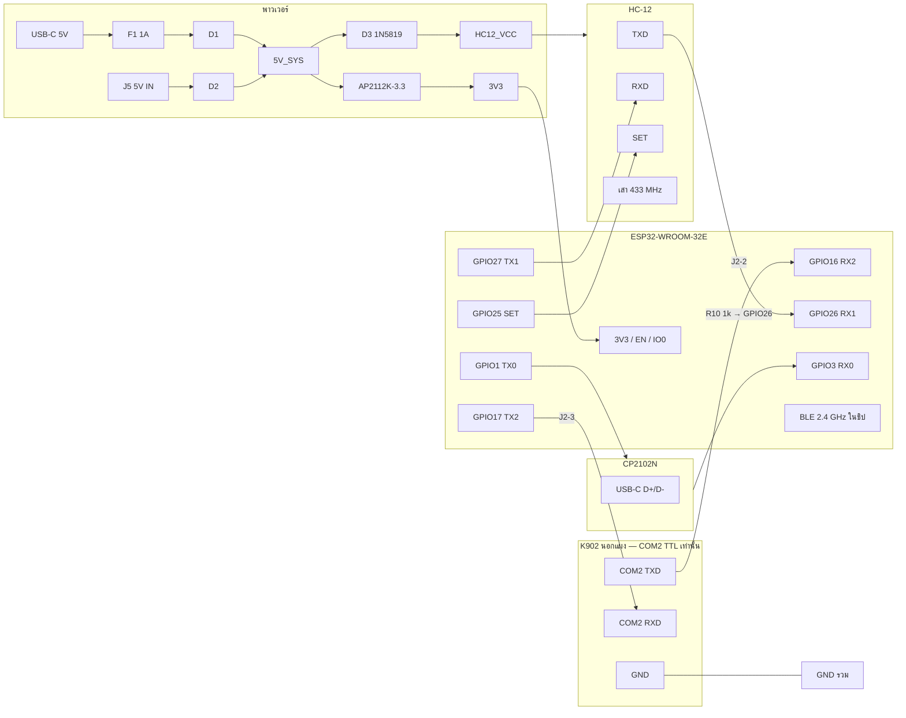

# GNSS Radio PCB — interconnect (BASE + ROVER)

แผงเดียว สองเฟิร์มแวร์ ไม่มีสวิตช์วิทยุบนฮาร์ดแวร์

| รายการ | ค่าที่อ่านจากเฟิร์มแวร์ (`src/main.cpp`, `src/Hc12Radio.cpp`) |
| --- | --- |
| โปรเจกต์ | `c:\project\ESP32_Rover_NEZ` |
| บอร์ด PlatformIO | `board = esp32dev` ทั้งคู่ |
| ROVER | env `esp32dev`, `K902_BASE_BUILD=0`, BLE name `GNSS` |
| BASE | env `esp32dev_base`, `-DK902_BASE_BUILD=1`, BLE name `GNSS-BASE` |
| K902 | UART2, 115200 8N1, **COM2 TTL 3.3 V เท่านั้น** |
| HC-12 | UART1, SET=GPIO25, ช่อง 1 = 433.4 MHz, FU3, P8, งาน 115200 |
| BLE | วิทยุใน ESP32 — **ไม่มีโมดูล BT แยก** |
| สลับ 433 / NTRIP | สวิตช์ในแอป — **ไม่มี GPIO สวิตช์วิทยุ** |
| `esp32_hotspot` | **ไม่อยู่ในพาธวิทยุนี้** |

ไฟล์คู่กัน: `pinmap.csv`, `bom.csv`, `gnss-radio.net` (KiCad sexp netlist)

---

## 1. โมดูลทั้งหมด

| โมดูล | อยู่บน PCB นี้? | แนะนำ |
| --- | --- | --- |
| ESP32 | ใช่ | **ESP32-WROOM-32E** (4 MB, เสา PCB) ลง SMT — อย่าลง DevKit 30 ขาบนบอร์ดผลิต DevKit ใช้แค่โปรโต |
| K902 | **ไม่** (ต่อสาย) | OEM LGA 54 ขา / EVK มี RF ของตัวเอง ต่อเฉพาะ **COM2 TTL** |
| HC-12 Si4463 | เสียบเฮดเดอร์ 2.54 | ตัวเดียวกันทั้ง BASE และ ROVER |
| USB-UART | ใช่ | CP2102N (หรือ CH340C) + USB-C |
| แหล่ง 5 V | USB-C และ/หรือ JST-PH | พาวเวอร์แบงก์ 5 V ≥ 1.5 A |
| LDO 3.3 V | ใช่ | AP2112K-3.3 (600 mA) เลี้ยง ESP32 + USB-UART เท่านั้น |
| LED | PWR เขียว บน 3V3 | เฟิร์มแวร์ยังไม่ขับ GPIO LED |
| ปุ่ม | RST (EN), BOOT (IO0) | แฟลช/รีเซ็ต |
| LTE hotspot | **ไม่** | โปรเจกต์ `esp32_hotspot` คนละบอร์ด |

K902 บน EVK ใช้ VIN **5–12 V ของตัวมัน** อย่าป้อน VIN จาก 3V3 ของแผงนี้

---

## 2. Power tree

```
USB-C VBUS ── F1 PTC 1A ── D1 SS14 ──┐
                                     ├── 5V_SYS ── U3 AP2112K-3.3 ── 3V3 ── ESP32 / CP2102N / pull-up / LED
J5 5V IN ─────────────── D2 SS14 ───┤           │
                                     │           └── EN, IO0, HC12_SET pull-up
                                     └── D3 1N5819 ── HC12_VCC (~4.3–4.7 V) ── HC-12 pin1
                                                    C6 220 µF + C7 100 nF ที่โมดูล

K902 EVK VIN ── แหล่ง 5–12 V คนละทาง (GND รวมกับแผงนี้เท่านั้น)
```

งบกระแส (แผงนี้ **ไม่** รวม K902):

| โหลด | Idle | พีค |
| --- | ---: | ---: |
| ESP32 BLE + Classic SPP | 80–150 mA | 300–350 mA |
| CP2102N + LED | 15 mA | 20 mA |
| HC-12 FU3 | 16 mA | **100 mA TX** (P8 / 20 dBm) |
| **5V_SYS รวม** | ~220 mA | **~550–650 mA** |

แหล่ง 5 V แนะนำ **1.5–2 A** BASE ส่งยาว — D3 + C6 จำเป็นตามคู่มือ HC-12

อย่าใช้พอร์ต USB ของโน้ตบุ๊กอย่างเดียวตอนทดสอบ TX ยาว

---

## 3. ตารางขา (source of truth = เฟิร์มแวร์)

ทิศทางเขียนจากมุม ESP32

| เน็ต | ESP32-WROOM ขา | GPIO | ต่อกับ | ระดับ | เฟิร์มแวร์ |
| --- | --- | --- | --- | --- | --- |
| UART2_RX | โมดูล pin 27 | **GPIO16** | J2-2 ← K902 COM2 **TXD** | 3.3 V TTL | `K902_RX_PIN 16` Serial2 |
| UART2_TX | โมดูล pin 28 | **GPIO17** | J2-3 → K902 COM2 **RXD** | 3.3 V TTL | `K902_TX_PIN 17` Serial2 |
| UART1_RX | โมดูล pin 11 | **GPIO26** | J3-4 ← HC-12 **TXD** ผ่าน R10 1 kΩ | 3.3 V (คลัมป์ถ้า >3.6 V) | `HC12_RX_PIN 26` UART1 |
| UART1_TX | โมดูล pin 12 | **GPIO27** | J3-3 → HC-12 **RXD** | 3.3 V | `HC12_TX_PIN 27` UART1 |
| HC12_SET | โมดูล pin 10 | **GPIO25** | J3-5 HC-12 **SET** + R3 10 kΩ ไป 3V3 | 3.3 V | `HC12_SET_PIN 25` HIGH=โปร่งใส LOW=AT |
| UART0_TX | โมดูล pin 35 | GPIO1 | CP2102N RXD | 3.3 V | `Serial.begin(115200)` |
| UART0_RX | โมดูล pin 34 | GPIO3 | CP2102N TXD | 3.3 V | แฟลช / มอนิเตอร์ |
| EN | โมดูล pin 3 | EN | 10 kΩ↑ 3V3, 100 nF↓ GND, SW1, Q2 | 3.3 V | สตรัป |
| IO0 | โมดูล pin 25 | GPIO0 | 10 kΩ↑ 3V3, SW2, Q1 | 3.3 V | HIGH=บูต SPI, LOW=ดาวน์โหลด |
| 3V3 | โมดูล pin 2 | — | LDO OUT | 3.3 V | |
| GND | โมดูล pin 1, 15, 38 | — | pour | 0 V | |

ขาที่ใช้แล้ว **ไม่ใช่** สตรัป 0/2/12/15 — อย่าเอาสัญญาณใหม่ไปที่ 0, 2, 12, 15  
GPIO12 ต้องเป็น LOW ตอนบูต (แฟลช 3.3 V) — **ปล่อยลอย ห้าม pull-up**  
ขาแฟลชภายในโมดูล (SD0–SD3, CMD, CLK) **ห้ามเดินสาย**

---

## 4. แผนภาพเน็ต



ระดับแรงดัน UART (คอนเซอร์เวทีฟ):

| เส้น | ทำไมไม่ใส่ level shifter ทั้งบอร์ด |
| --- | --- |
| ESP32 GPIO17 → K902 RXD | ทั้งคู่ 3.3 V LVCMOS/LVTTL |
| K902 TXD → ESP32 GPIO16 | ทั้งคู่ 3.3 V — **ห้าม DB9 RS-232** (±5…12 V จะเผา ESP32) |
| ESP32 GPIO27 → HC-12 RXD | คู่มือ V2.6: RXD รับ 3.3–5 V TTL มี 10 kΩ ขึ้นไป 3.3 V ในโมดูล — 3.3 V ตรงได้ |
| HC-12 TXD → ESP32 GPIO26 | STM8 ในโมดูลเป็น 3.3 V + ซีรีส์ 1 kΩ; pull-up อ่อนไป VCC ทำให้ไฮ ~3.3–3.5 V — ใส่ **R10 1 kΩ ซีรีส์** เสมอ; ถ้าวัดได้ >3.6 V ค่อยลง **D4 BAT54S** คลัมป์ไป 3V3 |
| ESP32 GPIO25 → HC-12 SET | SET เป็น 3.3 V, pull-up ในโมดูล 10 kΩ + ซีรีส์ 1 kΩ — ตรงได้ + R3 10 kΩ ไป 3V3 |

---

## 5. ASCII schematic (เน็ตหลัก)

```
                    USB-C                 J5 5VIN
                   VBUS D+ D- CC1 CC2      5V  GND
                     |   |  |   |   |      |    |
                    F1   \  /  5.1k 5.1k   D2   |
                     |    ESD U4    |   |   |    |
                     D1    |        GND GND |    GND
                      \    |                /
                       +-- 5V_SYS ---------+
                       |         |
                      U3        D3
                    3.3V LDO     |
                       |      HC12_VCC -- C6 220u -- C7 100n -- GND
                      3V3         |
                       |          |  J3 HC-12 2.54mm
         10k          |          |  1 VCC  2 GND  3 RXD  4 TXD  5 SET
    3V3--R1--+-- EN --o U1 ESP32-WROOM-32E                     |
         C8  |         pin3 EN                                 |
        100n GND       pin25 IO0 --+-- R2 10k -- 3V3           |
                       pin2  3V3   |                            |
                       pin1  GND   +-- SW2 BOOT -- GND          |
                       pin35 TXD0 ---- UART0_TX -- CP2102N RXD  |
                       pin34 RXD0 ---- UART0_RX -- CP2102N TXD  |
                       pin27 IO16 ---- UART2_RX -- J2-2 K902_TXD
                       pin28 IO17 ---- UART2_TX -- J2-3 K902_RXD
                       pin11 IO26 ---- UART1_RX -- R10 1k -- J3-4 TXD
                       pin12 IO27 ---- UART1_TX ----------- J3-3 RXD
                       pin10 IO25 ---- HC12_SET --+-------- J3-5 SET
                       PCB ANT 2.4GHz              |
                       (keep-out)              R3 10k to 3V3

    J2 JST-XH 4P K902 COM2 TTL
      1 GND
      2 K902_TXD  = COM2 TX  (EVK 16-pin #13 TX_COM2)
      3 K902_RXD  = COM2 RX  (EVK 16-pin #6  RX_COM2)
      4 NC
      silk: "COM2 TTL 3.3V — NOT DB9"
```

Auto-program (ลง Q1/Q2 เป็นค่าเริ่ม — อย่าลง C9/C10 พร้อมกัน):

```
CP2102N RTS -- R7 10k -- Q1 2N7002 G    Q1 D --> IO0   Q1 S --> GND
CP2102N DTR -- R8 10k -- Q2 2N7002 G    Q2 D --> EN    Q2 S --> GND
```

---

## 6. คอนเนกเตอร์ — ปักลงซิลค์สกรีนตามนี้

### J2 K902 COM2 (JST-XH 4P 2.54 mm) มองจากด้านหน้าตัวผู้บน PCB

| ขา J2 | เน็ต | สายไป K902 / EVK |
| --- | --- | --- |
| 1 | GND | GND (EVK pin 1 หรือ 15) |
| 2 | UART2_RX | **TX_COM2** EVK pin 13 |
| 3 | UART2_TX | **RX_COM2** EVK pin 6 |
| 4 | NC | ห้าม VIN, ห้าม RS-232 |

สายไขว้ TX↔RX แล้ว: K902 TXD → ESP32 RX, K902 RXD ← ESP32 TX  
COM2 บน EVK = **LVCMOS 3.3 V** (คู่มือ ComNav)  
**DB9 บน EVK เป็น RS-232 — ห้ามต่อ GPIO**

ถ้าใช้ EVK ที่มี DIP สวิตช์: COM2 ต้องวิ่งไป 16-pin ไม่ใช่ USB/BT ของ EVK

### J3 HC-12 (1×5 ระยะ 2.54 mm) = ขาโมดูล 1–5 ตรง ๆ

| ขา J3 | HC-12 | เน็ต PCB |
| --- | --- | --- |
| 1 | VCC | HC12_VCC |
| 2 | GND | GND |
| 3 | RXD | UART1_TX (GPIO27) |
| 4 | TXD | UART1_RX ผ่าน R10 (GPIO26) |
| 5 | SET | HC12_SET (GPIO25) + R3 |

เว้นที่ตัวโมดูล 27.8 × 14.4 mm + IPEX/สปริง อย่าเดินกราวด์ใต้เสา

### J4 PROG 1×6 (สำรอง ถ้าไม่มี USB-C)

| ขา | เน็ต |
| --- | --- |
| 1 | 3V3 |
| 2 | UART0_TX (GPIO1) |
| 3 | UART0_RX (GPIO3) |
| 4 | IO0 |
| 5 | EN |
| 6 | GND |

ถ้าเสียบ USB-UART นอก ขณะ USB-C enumerate อยู่ — อย่าขับ TX พร้อมกัน

### J1 USB-C

CC1, CC2 แต่ละเส้น 5.1 kΩ → GND (โหมด sink 5 V)  
D+/D− ผ่าน USBLC6-2 แล้วเข้า CP2102N  
**หมายเหตุ:** เบอร์ขา CP2102N ใน `gnss-radio.net` ต้องทวนกับ datasheet ชุดที่ซื้อ (QFN28) — **ชื่อเน็ตในเอกสารนี้เป็นตัวจริง** เบอร์ขาแพ็กเกจให้ตามซิมโบล KiCad `Interface_USB:CP2102N-Axx-GQFN28`

---

## 7. Decoupling / บูต / SET

| ส่วน | ค่า | ทำไม |
| --- | --- | --- |
| 3V3 ที่ U1 pin 2 | 10 µF + 100 nF ติดขา | ESP32 TX/BLE สไปก์ |
| EN | 10 kΩ → 3V3, 100 nF → GND | รีเซ็ตตอนจ่ายไฟ, กรองรีเซ็ต |
| IO0 | 10 kΩ → 3V3 | บูตจากแฟลช |
| LDO IN/OUT | 1 µF IN, 10 µF+100 nF OUT | AP2112K |
| 5V_SYS | 100 nF | |
| HC12_VCC | 220 µF + 100 nF | คู่มือขอ ≥22 µF (ดีสุด 1000 µF) — ถ้า BASE รีเซ็ตตอน TX ให้เพิ่มอิเล็กโทรไลต์ TH |
| HC12_SET | 10 kΩ → **3V3** (ไม่ใช่ 5 V) | โปร่งใสตอน ESP32 รีเซ็ต; เฟิร์มแวร์ `digitalWrite(HIGH)` หลัง `begin` |
| USB-C CC | 5.1 kΩ ×2 → GND | ไม่มีแล้วโทรศัพท์/อะแดปเตอร์ไม่จ่าย 5 V |

อย่าต่อ LED ที่ขา TxD ของ HC-12 (คู่มือห้าม — กวน UART)

---

## 8. เสาอากาศ / เลย์เอาต์

บอร์ดแนะนำ ~50 × 80 mm, FR4 1.6 mm, 2 ชั้น (4 ชั้นดีกว่าถ้ามีงบ), ENIG

```
[ เสา ESP32 2.4 GHz ]----[ ESP32 ]--[ LDO USB ]--[ J2 K902 ]----[ HC-12 + เสา 433 ]
     ขอบฟรี ไม่มีทองแดง                              ขอบตรงข้าม ไม่ทับ keep-out
```

| กฎ | รายละเอียด |
| --- | --- |
| ESP32 เสา PCB | โมดูลชิดขอบสั้น; keep-out ตาม Espressif (~15 mm หน้าเสา) **ห้ามกราวด์/แพลนใต้เสา** ห้ามโลหะกล่องทับ |
| HC-12 433 MHz | คนละขอบกับเสา 2.4 GHz **อย่างน้อย 40–50 mm** และอย่าขนานสายเสา |
| กราวด์ | pour GND ทั้งสองชั้น; เวียเยอะรอบโมดูล ESP32 และรอบ HC-12 **ยกเว้น** โซนเสา |
| UART | UART2 (K902) และ UART1 (HC-12) คนละคู่ เดินขนานสั้น ๆ GND ข้าง ๆ; อย่าพาดใต้เสา |
| USB | D+/D− ยาวเท่ากัน ชิดกัน อิมพีแดนซ์ ~90 Ω diff ถ้าทำได้ |
| 3V3 / 5V | หนา ≥0.4 mm; HC12_VCC หนา เพราะพัลส์ 100 mA |
| ห้ามทับ | เสา GNSS ของ K902 (บนกล่อง/เสาสำรวจ) ห่างวิทยุ 433 และ Wi‑Fi/BLE ของ ESP32 ให้มากที่สุดในกล่อง |

BLE ใช้เสา 2.4 GHz ของ WROOM — แรง TX เฟิร์มแวร์ `ESP_PWR_LVL_P9` อย่าบังเสาด้วยกราวด์หรือแบต

---

## 9. BASE กับ ROVER

**บอร์ดเดียวกัน BOM เดียวกัน** ไม่มี stuffing ต่าง

| | BASE | ROVER |
| --- | --- | --- |
| แฟลช | `pio run -e esp32dev_base -t upload` | `pio run -e esp32dev -t upload` |
| ชื่อบลูทูธ | `GNSS-BASE` | `GNSS` |
| ฮาร์ดแวร์ | เหมือนกันทุกเน็ต | เหมือนกันทุกเน็ต |
| HC-12 | ตัวเดียวกัน ช่อง 1 | ตัวเดียวกัน ช่อง 1 |
| สลับ 433/NTRIP | ไม่มีสวิตช์บน PCB | สวิตช์ในแอป |

ทำ PCB สองใบจากไฟล์เดียวกัน แปะซิลค์ `BASE` / `ROVER` ด้วยปากกาหลังแฟลช

---

## 10. Footprint KiCad (copy ลงโปรเจกต์ใหม่)

| Ref | ซิมโบล | Footprint |
| --- | --- | --- |
| U1 | `RF_Module:ESP32-WROOM-32` | `RF_Module:ESP32-WROOM-32` |
| U2 | `Interface_USB:CP2102N-Axx-GQFN28` | `Package_DFN_QFN:QFN-28-1EP_5x5mm_P0.5mm_EP3.35x3.35mm` |
| U3 | `Regulator_Linear:AP2112K-3.3` | `Package_TO_SOT_SMD:SOT-23-5` |
| U4 | `Power_Protection:USBLC6-2SC6` | `Package_TO_SOT_SMD:SOT-23-6` |
| J1 | `Connector:USB_C_Receptacle_USB2.0` | `Connector_USB:USB_C_Receptacle_GCT_USB4105-xx-A_16P_TopMnt_Horizontal` |
| J2 | `Connector_Generic:Conn_01x04` | `Connector_JST:JST_XH_B4B-XH-A_1x04_P2.54mm_Vertical` |
| J3 | `Connector_Generic:Conn_01x05` | `Connector_PinHeader_2.54mm:PinHeader_1x05_P2.54mm_Vertical` |
| J4 | `Connector_Generic:Conn_01x06` | `Connector_PinHeader_2.54mm:PinHeader_1x06_P2.54mm_Vertical` |
| J5 | `Connector_Generic:Conn_01x02` | `Connector_JST:JST_PH_B2B-PH-K_1x02_P2.00mm_Vertical` |

นำเข้าเน็ต: KiCad → PCB Editor ไม่สามารถสร้างวงจรจาก `.net` อย่างเดียวได้สมบูรณ์ใน v8 — **วาด schematic จากตารางเน็ตนี้** แล้ว annotate ให้ตรง `gnss-radio.net`  
หรือใช้ `import netlist` ใน Pcbnew (legacy) หลังสร้างซิมโบลครบ

ตรวจ ERC: ไม่มีพาวเวอร์แฟล็กชนกัน, GND ทุกโมดูลร่วม, J2-4 NC, IO12 ไม่มี pull-up

---

## 11. คำเตือน (อ่านก่อนเดินสาย / ส่งโรงงาน)

1. **K902 RS-232 vs TTL** — DB9 ของ EVK เป็น RS-232 ห้ามเข้า GPIO16/17 ใช้ COM2 TTL / 16-pin LVCMOS 3.3 V เท่านั้น
2. **HC-12 5 V** — VCC จาก HC12_VCC (หลัง D3) ไม่ใช่ 3V3; UART ยังเป็น 3.3 V; SET pull-up ไป **3V3**
3. **สตรัป ESP32** — สัญญาณใหม่ห้าม GPIO 0, 2, 12, 15; GPIO12 ห้ามดึงขึ้น
4. **เสา** — 2.4 GHz กับ 433 MHz คนละขอบ ห้ามทับ keep-out ห้ามกราวด์ใต้เสา
5. **กระแส** — BASE TX ต่อเนื่อง ~100 mA ที่ HC-12 + ESP32 BLE; USB 500 mA อาจไม่พอ; ใช้ 5 V 1.5–2 A; C6 ต้องมี
6. **ไม่มีสวิตช์วิทยุ** — อย่าเผื่อสวิตช์ GPIO สำหรับ 433/NTRIP
7. **ไม่มีโมดูล BT แยก / ไม่มี LTE บนแผงนี้**
8. **อย่าเลี้ยง K902 EVK จาก 3V3** — VIN 5–12 V คนละเรกูเลเตอร์ GND รวม
9. **วัด HC-12 TXD ก่อนต่อถาวร** — ถ้าไฮ >3.6 V ลง D4
10. **CP2102N เบอร์ขา** — ทวน datasheet; เชื่อชื่อเน็ตในตาราง

---

## 12. เช็กลิสต์ก่อนส่ง Gerber

- [ ] GPIO16/17/25/26/27 ตรงตารางเฟิร์มแวร์
- [ ] J2 ซิลค์ `TTL 3.3V NOT DB9` และ TX/RX ไม่สลับจากตาราง
- [ ] J3 pin1 = HC12_VCC ไม่ใช่ 3V3
- [ ] R3 SET → 3V3, R1 EN → 3V3, R2 IO0 → 3V3
- [ ] USB-C มี 5.1 kΩ CC
- [ ] เสา WROOM ชิดขอบ; HC-12 คนละด้าน
- [ ] ไม่มีเน็ตไป GPIO12
- [ ] BASE/ROVER ไม่มี BOM แยก
- [ ] DRC ช่องไฟ 0.15 mm, แหวน 0.15 mm ขึ้นไป (โรงงาน 2 ชั้นมาตรฐาน)
